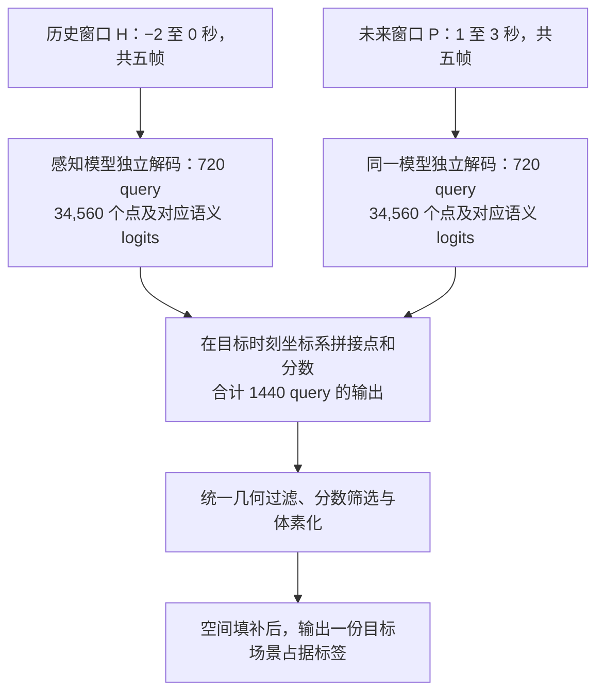

# A1｜多保留一些历史图像，未来感知会更好吗？

[返回总览](README.md) · [下一篇：A2 距离与观测](a2_migration.md)

> **先看结论：**历史与未来图像的组合能改善一部分静态区域，但这次尝试没有提高整体 mIoU。局部改善还受到输出点数的明显影响。
>
> 范围：150 个场景，每场景一个样本；评估 1／2／3 秒。正文先看 3 秒，全部时距和区间见[统计附表](statistics.md#a1)。

## 为什么要做这个实验？

原来的比较中，预测器 F 读取历史图像，感知器 P 读取未来图像。**P 的窗口向未来平移后，一些历史帧就被移出了输入。**因此，P 局部表现较差，可能与历史证据的丢失有关。

我们把问题拆成两步：先让输入帧数保持相同，改变其中历史与未来的比例；再保留两个完整窗口，检查融合输出是否有帮助。


*读图：每行选五个时刻，每个时刻有六个相机视角。混合窗口 M 从 H 与 P 的并集中等间隔选择。这里画的是实际使用的 3 秒配置。*

## 四个字母分别表示什么？

| 名称 | 输入图像 | 如何得到未来场景 |
|---|---|---|
| **F：预测器** | 当前及过去四帧 | 使用原版未来预测模块 |
| **H：历史窗口感知** | 与 F 相同的五帧 | 将图像投影关系对齐到目标坐标，再使用感知头 |
| **P：未来窗口感知** | 以目标时刻结尾的五帧 | 使用感知头 |
| **M：混合窗口感知** | 历史与未来合计五帧 | 使用同一个感知头 |

**H 与 F 虽然读相同的历史图像，但经过的模块不同。**H 是用于比较输入信息的诊断组，不能当作 F 的另一个名字。H、P、M 都使用 720 个 query；一个 query 最终输出 48 个三维点。

## 先看等帧数比较，再看双窗口融合

下表“局部”特指：**只进入未来输入窗口视锥、没有进入历史窗口视锥的静态 GT 体素**。视锥只描述几何覆盖，不保证实际无遮挡。

{{A1_SHORT}}

整体 mIoU 评估全场景，兼顾漏检、误报和类别错误；局部准确率只问这组真实存在的体素有多少被判对。**两个指标分母不同，不能互换。**


*读图：左图比较整体 mIoU，右图比较指定静态区域的准确率。比较同一图内的柱高；两张图的分数不是同一种指标。*

**混合五帧 M 的结果最能说明这个区别：**该局部区域相对 P 提高 **3.55 个百分点**，95% 区间为 `[1.68, 5.38]`；但整体 3 秒 mIoU 从 **17.71% 降到 16.86%**。历史信息对部分位置有帮助，仍不足以让整个场景变得更准确。

<a id="dual-window-fusion"></a>

## 双窗口融合 1440 query，具体怎样操作？

**同一个感知模型分别处理 H、P 两个五帧窗口，再拼接两次解码得到的三维点和语义分数，统一生成体素结果。**1440 来自 H 的 720 个 query 加上 P 的 720 个 query；一个 query 输出 48 个点，所以融合前共有 **69,120 个点**，过滤后实际保留的点数会减少。



*以 3 秒为例，图中的窗口每 0.5 秒取一帧，每帧包含六个相机视角。两次前向使用相同的冻结权重，H 与 P 的特征分别解码，在点输出阶段汇合。*

### 第一步：让两支输出使用同一个坐标系

根据各帧相机与目标时刻车辆的位姿调整投影矩阵，使 H、P 都在 **3 秒后的车辆坐标系**中生成点，然后直接拼接。H 用历史图像经过感知模块输出，与原始预测器 F 的未来预测路径不同；本组融合的两支是 **H 与 P**。

### 第二步：拼接点及其类别分数

每支输出点坐标 `[1, 34560, 3]` 和 17 类语义 logits `[1, 34560, 17]`，沿点维度拼接后分别变成 `[1, 69120, 3]` 和 `[1, 69120, 17]`。

```python
# 说明核心操作；H、P 已分别完成解码，输出位于同一目标坐标系。
points = torch.cat([H_points, P_points], dim=1)
logits = torch.cat([H_logits, P_logits], dim=1)
occupancy = render(model, points, logits)
```

融合没有引入新的跨窗口 attention 或可学习权重；“1440 query”描述的是两次解码的合计输出预算，不表示一次联合解码中让 1440 个 query 共同交互。

### 第三步：在统一体素化过程中处理重叠

先把 logits 转成类别分数，按原版设置执行 query 组几何过滤和分数筛选，再把保留的点放入 0.4 m 网格。若 H、P 的点落到同一体素，**每个类别分别取所有落入点的最大分数**，随后进行空间填补，并根据类别阈值和最高分确定最终标签。

因此，融合发生在原始点与分数层面，最终只做一次统一渲染；它不对两份已经生成的体素标签平均或投票，也不根据 GT 挑选正确分支。实现见[点集拼接](../../../../tools/run_sparseworld_region_ablations.py)的 `HP_full` 分支，以及[体素化器](../../../../model/head/sparseworld_strict_head.py)的 `_Rasterizer.forward()`。

### 为什么还需要“融合 720 query”这一组？

完整融合同时增加了历史输入和点预算。为了检查额外覆盖的影响，我们用固定种子从 H、P **各随机保留 360 个完整 query**，合计 720 个、34,560 个点，再执行相同的拼接与渲染。

| 设置 | H 保留 query | P 保留 query | 总点数（过滤前） | 3 秒局部准确率 |
|---|---|---|---|---|
| 完整融合 `HP_full` | 720 | 720 | 69,120 | 60.43% |
| 等点数融合 `HP_equal_points` | 360 | 360 | 34,560 | 38.12% |

这里的局部仍指“只进入未来窗口视锥的静态 GT”。局部准确率从 **60.43% 降到 38.12%**，说明融合收益不能全部归给“多看到了历史图像”，额外覆盖及后处理也参与了结果；随机删 query 同时改变身份与空间分布，不能据此把差额全部归因于数量。

这两组都保留 H、P 两次独立解码，720 组只在输出后删点，因此是**等输出点预算对照**，不代表与单窗口感知器计算量相等。

作为对照，将 H 或 P 自己的输出复制一份再融合，体素结果完全不变。这是确定性输出的重复融合检查，没有用它测量双次解码时延。

## 让输出头适应新的窗口，结论会改变吗？

我们还分别对 H、P、M 做了相同预算的短程适配：256 个训练场景，每组 768 次更新，三个种子。只训练最后的语义与几何输出分支；图像编码和特征交互保持冻结。下表为三个种子的均值 ± 标准差。

{{A1_ADAPT_SHORT}}

适配后，M 仍在这个静态子集上高于 P，而整体 3 秒 mIoU 仍低于 P。局部互补与整体代价并存的现象没有在这次有限适配中消失。

## 这一步支持什么判断？

- **已有依据：**历史与未来窗口在部分位置上具有互补性，输出点预算会明显影响这种互补能否体现出来。
- **还不能确定：**完整联合输入、充分训练后的编码器能达到什么水平。本次双窗口融合发生在输出端，适配也只更新了输出头。

这引出了 [A3 的问题](a3_sparse_representation.md)：当点的数量和分布受到控制后，预测器的局部优势是否还能保留？
