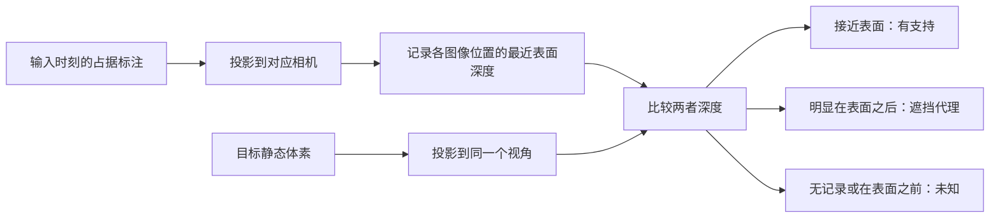

# A2｜“离车近”——是离当前车近，还是离未来车近？

[返回总览](README.md) · [上一篇：A1 窗口](a1_windows.md) · [下一篇：A3 稀疏表示](a3_sparse_representation.md)

> **先看结论：**“当前近处整体更适合预测器”没有得到支持。更具体的规律是：部分距当前车 10–30 m、距目标时刻车 ≥30 m 的静态区域偏向 F。
>
> 范围：距离分析为 512 样本／150 场景；观测质量为其中每场景一个样本。下文主要看 3 秒。

## 同一个结构，为什么会有两个距离？

静态建筑可以一直停在原地，但车辆在向前行驶。于是，**同一个世界位置到当前车辆的距离，与它到未来车辆的距离不同**。只按未来坐标图上的“近／远”解释模型优势，可能忽略历史输入曾经从哪里观察它。

*这是几何示意，不是实验样本。分析中我们把目标体素经世界坐标映射到当前坐标，再计算两个水平距离。对于动态类别，“当前距离”指未来目标位置到当前车的距离，不是物体的历史位置。*

## 先检验最直接的说法：当前 10 米内，F 是否整体更好？

下面统一使用 **P−F = 感知器准确率 − 预测器准确率**。正数偏向 P，负数偏向 F；方括号是场景级 95% 区间。

{{A2_NEAR_TABLE}}

当前 10 m 内，全部占据体素上 P 仍领先 **2.88 个百分点**。只看静态体素时，差值是 **+1.06**，区间跨过 0。因此，这组统计没有建立“当前近处静态结构由 F 整体占优”的结论。

## 同时看两个距离，局部规律才更清楚

*读图：先选纵轴的“当前距离”，再选横轴的“目标距离”。红色表示 P 更好，蓝色表示 F 更好；格内数字是百分点差。每格汇总该组 GT 占据体素，颜色不是绝对准确率。少于 20 个场景支持的格子留白，色阶截断于 ±20。*

{{A2_CROSS_TABLE}}

例如，同样是未来 ≥30 m 的静态位置，**当前在 10–30 m 的子组偏向 F，而当前也在 ≥30 m 的子组偏向 P**。因此，“曾经离车较近、后来变远”是有价值的细分条件。

这仍是条件关联：类别构成、观测支持和稀疏点分布都可能同时变化。交叉表中的细分也属于本轮探索性分析。

## 距离之外，历史图像是否留下了几何支持？

我们进一步统计实际输入中的三个属性：

| 属性 | 用直观语言理解 | 需要保留的边界 |
|---|---|---|
| 视锥覆盖次数 | 一个体素落入多少个输入相机视角 | 落入图像范围不代表无遮挡 |
| 最大投影尺度 | 0.4 m 体素在图像中大约占多大 | 没有进入任何视锥时记为 0 |
| 几何深度支持 | 该位置的深度是否接近输入时刻标注的表面 | 来自占据标注，不是真实相机深度 |

深度支持的计算过程如下。它用于近似判断几何证据是否存在，不直接提供“真实可见”的标签。

我们在相同类别、相同目标距离的分组内比较，再合并结果。3 秒时，**有历史窗口深度支持的组，其 P−F 比零支持组低 8.37 个百分点**，区间为 `[-9.72, -7.06]`；即这项条件更偏向 F。

这里的 **−8.37 是两组 P−F 的差**，并不表示“有支持组中 F 就绝对领先 8.37”。对 P 窗口做相同分析，3 秒差值为 −0.71，区间 `[-2.03, 0.57]`，没有稳定排除 0。全时距数值见[统计附表](statistics.md#a2)。

## 这一步支持什么判断？

联合距离与历史几何支持能够帮助描述“F 在哪里相对更强”，但还不能证明模型确实在使用某些特定图像内容。[A4 的遮挡实验](a4_input_interventions.md)会直接改变输入，进一步检验这种依赖。
